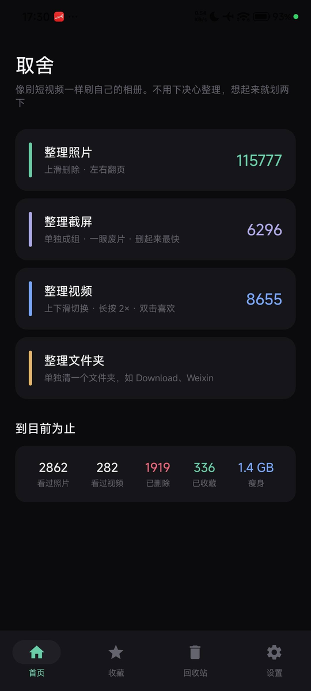
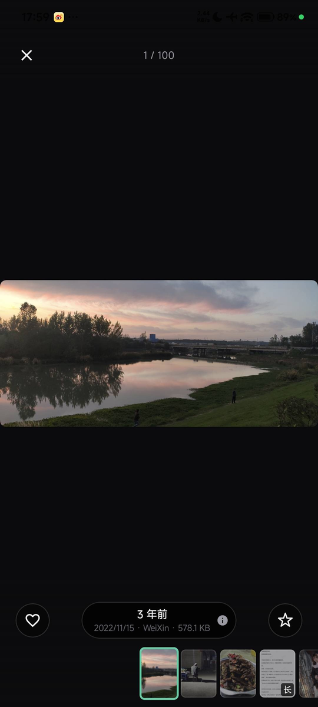
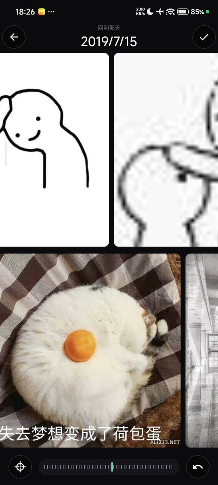
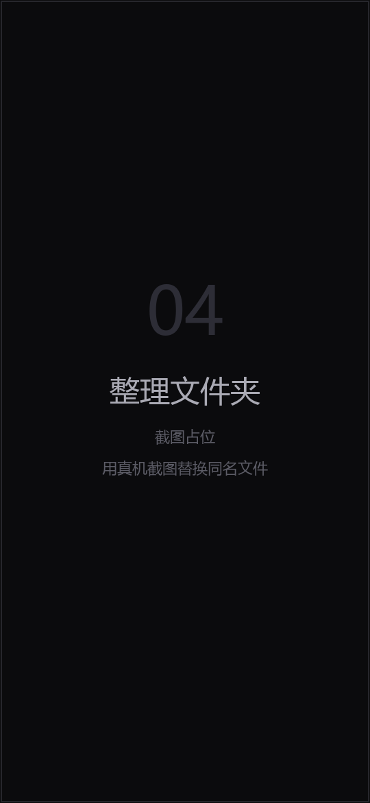

# 取舍 (Qushe)

> **不想自己编译？** [下载最新版 APK](https://github.com/akailaler/qushe-app/releases/latest)
>   
> —— Android 11 及以上，约 3.7 MB，直接安装即可（正式签名，可直接覆盖升级）。

参考了 iOS「去留 linger」的 Android 实现。像刷短视频一样刷自己的相册：随机抽一组内容，
  
顺手删掉废片、收藏想留的，过程中不断看到尘封的记忆。

照片用**卡片堆叠 + 上滑删除**，视频用**抖音式上下滑 + 长按倍速 / 双击收藏**。

<p align="center">
  
  &nbsp;
  
  &nbsp;
  
  &nbsp;
  
</p>

<p align="center">
  <sub>首页 · 收藏预览 · 回到那天 · 整理文件夹</sub>
</p>

当前版本 **1.3.99**（versionCode 147），已在小米 HyperOS 3.0 真机长期使用。

---

## 一、怎么跑起来

### 环境要求

| 项              | 版本                             |
| -------------- | ------------------------------ |
| JDK            | 17                             |
| Android SDK    | compileSdk 35 / build-tools 35 |
| AGP / Gradle   | 8.6.1 / 8.9                    |
| Kotlin         | 2.0.21                         |
| 最低运行版本         | **Android 11（API 30）**         |
| Android Studio | 可选。全部构建都能在命令行完成                |

`minSdk = 30` 是刻意选择：系统回收站（`MediaStore.createTrashRequest`）和受控删除
  
（`createDeleteRequest`）都是 API 30 起才有。低于 30 就必须申请 `WRITE_EXTERNAL_STORAGE`
  
直接操作文件——完全另一套代码路径，且更不安全。

### 构建

```bash
export JAVA_HOME=/path/to/jdk17
./gradlew assembleDebug assembleRelease lintDebug    # Windows: gradlew.bat ...
```

仓库自带 Gradle Wrapper（`gradle/wrapper/gradle-wrapper.jar`），**不需要预装 Gradle**；
第一次跑会自己下载 8.9 的发行包。想用本机已装的 `gradle` 也等价。

产物：

| 包                           | 体积         | 签名       | 用途                                           |
| --------------------------- | ---------- | -------- | -------------------------------------------- |
| `qushe-v1.3.99-release.apk` | **3.7 MB** | **正式签名** | 日常用这个——R8 裁剪过，启动和体积都更好                       |
| `qushe-v1.3.99-debug.apk`   | 33 MB      | debug 签名 | 调试用。`verify.py` 的收藏核对要靠它（`run-as` 只在可调试包上工作） |

⚠️ **两种包的签名不同，不能互相覆盖安装**（1.3.89 起 release 换成了正式签名）。
  
从 1.3.88 或更早升级需要**卸载重装一次**，之后每个版本都能正常覆盖。

**签名只说明一次**：APK 一直用作者本人的密钥签（`keystore/` 不进仓库）。
这一条只需记住「同一条签名线可以互相覆盖」，不必每个版本重复确认。

**为什么 debug 有 33 MB**：其中 99% 是 dex（native 库 44 KB、资源 761 KB）。
  
删 ABI、压资源都是无效功，**唯一有效的是 R8**：`isMinifyEnabled + isShrinkResources`
  
之后 32.6 → 3.7 MB（减 89%）。

release 包混淆过，崩溃堆栈要用 `app/build/outputs/mapping/release/mapping.txt` 反解
  
（39 MB，不进仓库，每次构建重新生成）。

### 发一个可下载的版本

```bash
./gradlew assembleRelease   # 约 40 秒
python release.py        # tag + Release + APK，一次传完
```

`release.py` 从 `versionName` 读版本号、自动打 tag、创建 Release、上传 APK，并把 APK 的 SHA-256 写进说明。
  
重复执行只补缺失的部分，不会重复创建。访客在
  
[Releases](https://github.com/akailaler/qushe-app/releases) 页面下载 ——
  
README 顶部那个链接指向 `releases/latest`，永远是最新版。

**为什么不用 GitHub Actions**：这个工程一直在本地真机上验证，发出去的应该是
  
"验过的这个包"，而不是云上重新编出来的另一个包；本机构建也只要 40 秒。
  
脚本取凭据走 `git credential fill`（GitHub Desktop / GCM 存的那份），不读明文文件。

### 首次启动

按需申请媒体权限。Android 13+ 图片 / 视频权限分开，只给照片权限也能用，
  
视频入口会单独提示补授权。Android 11~12 申请的是 `READ_EXTERNAL_STORAGE`（见 `permissionsFor()`）。

建议用真机——模拟器相册里通常没有足够内容来体验随机抽组。

### ⚠️ 工程路径不能含中文

Android 构建链在 Windows 上拒绝非 ASCII 路径。本工程当前在
  
`C:\Users\<用户名>\...\qushe-android` 这种含中文的路径，`gradle.properties` 里靠
  
`android.overridePathCheck=true` 绕过。若遇到 `aapt2` / 资源路径的诡异报错，
  
把工程挪到纯英文路径（如 `D:\code\qushe-android`）是最彻底的解法。

---

## 二、现在的功能

### 首页

三个入口：**整理照片**、**整理视频**、**按文件夹挑一批**（只从这个文件夹抽，不套用"只看没看过的"）。

底部四个 tab：**首页 / 收藏 / 回收站 / 设置**；首页**右滑**进「喜欢」——它是一条独立列表，
  
和"收藏"不是一回事，所以没占 tab 位。统计只记"已完成"，没有"还剩多少"。

### 手势

**照片整理**

| 手势   | 动作                      |
| ---- | ----------------------- |
| 左右滑  | 下一张（双向都是下一张，随机流里回退没有意义） |
| 上滑   | 标记删除，一组结束后统一执行          |
| 双击   | 喜欢 / 收藏（设置里可选，默认「喜欢」）   |
| 长按   | 播放实况照片的片段               |
| 单击   | 显示 / 隐藏界面               |
| 捏合缩小 | 进入「回到那天」                |

下滑**不触发任何动作**——收藏已经移到左下角按钮上。

**视频整理**

| 手势     | 动作                    |
| ------ | --------------------- |
| 上下滑    | 切换视频                  |
| 单击     | 暂停 / 继续               |
| 双击     | 喜欢 / 收藏（同一个设置）        |
| 长按     | 2 倍速                  |
| 侧边竖排按钮 | 收藏 / 删除 / 分享（可设左侧或右侧） |

**「回到那天」**

从某张照片捏合进入，围绕它的拍摄日展开上下两排连续横带。

| 手势         | 动作                     |
| ---------- | ---------------------- |
| 左右滑        | 横向浏览（两排共用同一个滚动位置，天然同步） |
| 点格子        | 放大查看                   |
| 格子上滑       | 标记删除                   |
| 底部刻度条      | 快速定位                   |
| 放大后捏合 / 拖动 | 缩放与平移；长图只解当前视口那一段      |
| 放大后下滑      | 回到横带                   |

### 收藏与喜欢

两个不同的东西，刻意用两种形状区分：

- **喜欢（红心）**：只存在本应用，绝不写系统相册。
- **收藏（星形）**：会写进系统相册的「收藏」夹。

**同步规则**：只做加法。每次同步读系统 `IS_FAVORITE` 减去本应用收藏夹，把差集写进去；
  
**绝不自动取消**系统里多出来的收藏（可能是别处写的）。取消收藏只在应用内生效。

小米相册刷新极慢，写完要重启相册或等一会儿才看得到——数据是对的，只是显示没刷新。

### 其他

- **时间格式**：相对时间 / 具体日期是**两个独立开关**，四种组合都支持。
- **删除**：默认进系统回收站（保留 30 天），可改为彻底删除；回收站页可逐项恢复。
- **设置项**：每组数量、相对时间、具体日期、只抽没看过的、删除进回收站、默认静音、
    
  自动播放、操作栏左右、双击画面做什么、显示拍摄地点、收藏同步（手动 / 反向导入）、统计清零。

---

## 三、代码地图

```
app/src/main/java/com/qushe/app/            （44 个文件，约 17k 行）
├── QusheApp.kt                  Application；注册 5 类 Coil 组件（系统缩略图 / 长图区域 / 视频帧 / GIF / 动图）
├── MainActivity.kt
├── core/
│   ├── Models.kt                MediaItem · MediaKind · storeKey 复合键 · isLongImage
│   ├── MediaRepository.kt       MediaStore 扫描、截屏归类、删除、回收站、系统收藏读写、地点
│   ├── SessionRepository.kt     随机抽组、收藏、已看轮次、系统收藏同步
│   ├── MotionPhoto.kt           实况照片：XMP 解析 + 文件头嗅探 + 片段抽取
│   ├── PhotoExif.kt             拍摄参数（光圈 / 快门 / ISO / 焦距）
│   ├── GeoLocation.kt           EXIF GPS → 省市区（带缓存）
│   ├── Prefs.kt                 设置 + 累计统计
│   ├── IdSetStore.kt / IdTimeStore.kt   已看 / 收藏 / 回收站剩余天数
│   ├── Permissions.kt           分系统版本的媒体权限
│   ├── Formatters.kt            体积 / 时长 / 相对时间
│   ├── SystemThumbnailFetcher.kt  ★ 直接读系统相册已生成的缩略图（1~2ms）
│   ├── LongThumbnailFetcher.kt    ★ 长图只解垂直居中 2:1 的一块
│   ├── RegionDecode.kt            ★ 长图放大时只解当前视口区域
│   ├── CrashLog.kt               未捕获异常落盘（设置页可导出）
│   └── AppContainer.kt           手写依赖容器
└── ui/
    ├── AppRoot.kt               导航、权限门、会话宿主、收藏同步、设置状态
    ├── common/
    │   ├── Gestures.kt           ★ 不消费事件的点击检测器
    │   ├── ZoomableImage.kt      ★ 缩放 / 平移 / 双击；长图区域解码
    │   ├── MediaPreviewOverlay.kt ★ 全屏预览（分页、下滑退出、可注入操作区与胶囊）
    │   ├── ThumbnailFilmstrip.kt 整理页底部的缩略胶片条
    │   ├── VideoSurface.kt       屏幕级单视图播放器（不建/毁，跟页偏移走）
    │   ├── ThumbnailRequest.kt   系统缩略图请求封装
    │   ├── ActionRail.kt / PreviewActionButton.kt / DoubleTapFlash.kt / VideoProgressBar.kt
    │   └── Geometry.kt / Shapes.kt / Motion.kt / 各类图标
    ├── photo/
    │   ├── PhotoSessionScreen.kt ★ 卡片堆叠 + 滑动决策 + 缩放 + 胶片条
    │   ├── DayViewScreen.kt      ★ 「回到那天」双排横带 · 原图比例 · 刻度条 · 橡皮筋
    │   └── PhotoInfoUi.kt        ★ InfoPill（胶囊）与详情面板的唯一实现
    ├── video/VideoSessionScreen.kt  抖音式上下滑
    ├── home/HomeScreen.kt           入口与统计
    ├── favorites/FavoritesScreen.kt
    ├── trash/TrashScreen.kt
    ├── settings/SettingsScreen.kt
    └── theme/Theme.kt
```

---

## 四、关键设计决策

改这个项目之前先读这一节。

### 1. 手势分层：导航归滑动，决策归点击

一个方向的手势只承担一件事。照片用照片的习惯（左右翻页），视频用视频的习惯（上下滑）。
  
删除、收藏这类"决策"不占用滑动方向——它们要么是点击（双击、侧边按钮），
  
要么是**可撤销的标记**（上滑只标记，结束时统一执行）。

### 2. 不消费事件的点击检测器

`detectTapGestures` 内部会 `down.consume()`，一旦消费，同一区域的 `VerticalPager`
  
就拿不到拖拽，视频流直接划不动。所以 `Gestures.kt` 里的 `detectTapsWithoutConsuming`
  
全程不 `consume`，用 `positionChangeConsumed()` 判断"这次其实是拖拽"。
  
长按判定还必须排除"拖到一半停住"（用 `dragged` 标志），否则滑到一半会误触发倍速。

### 3. 下一张"垫在下面"，不是"滑进来"

当前张跟手左移，下一张原地露出来。眼睛不用等下一张停稳就能看清内容，连滑几百张不累。
  
实现上把后面两张用相同位置渲染在底层，顶层用 `graphicsLayer.translationX` 位移——
  
走绘制阶段，不触发重新布局。

### 4. 删除必须"标记"与"执行"分离

上滑只标记，一组结束统一走系统授权对话框。原因：系统删除请求每次都弹框，
  
逐条删会被弹窗淹没；而彻底删除不可逆，批量确认是唯一的人工闸门。
  
用户在系统弹窗点"取消"时，这些项不计入"已删除"统计（看 `resultCode`）。

### 5. 只用 done list，不出现 todo list

界面上没有任何"还剩 N 项"。照片清理让人抗拒，是因为它像家务——
  
而家务的本质是"你还没做完"。所以整条产品线都不算剩下的量。

### 6. 图片和视频的 `_id` 会撞号

MediaStore 里图片和视频是两张独立的表，`_id` 都从 1 开始。
  
所以收藏、已看集合都用复合键 `storeKey()`（图片 `id*2`、视频 `id*2+1`），
  
否则收藏一张图会让某个视频莫名变成已收藏。

### 7. 回收站用系统的，不自己搬文件

`MediaStore.createTrashRequest` 走系统回收站，保留 30 天。
  
自己搬到应用私有目录的话，卸载 App 就全丢了，反而更不安全。

### 8. 缩略图垫在播放器底下

视频页先渲染 Coil 抽的首帧，播放器叠在上面，接管瞬间几乎无跳变。
  
单个页面只养**一个** ExoPlayer，翻页时换 `mediaItem`——相邻页各开一个是 OOM 的经典来源。

### 9. 缩放与滑动的手势归属

缩放组件只吃两种事件：双指，以及"已经放大之后的单指"。其余放行。
  
放大态外层不认领任何拖拽，所以上滑删除 / 左右翻页自然失效——那时用户在**看局部**，
  
不是在切照片。父层抢手势会让"放大后拖动"彻底失效，这条踩过。

### 10. 单击与双击共存：交给同一个检测器

单击显示/隐藏界面、双击喜欢——两者不能各用一个手势检测器（会互相打架）。
  
`ZoomableImage` 内部用 `detectTapsWithoutConsuming` 统一判定，单击延后 280ms 等第二击，
  
双击时取消挂起的单击。

---

## 五、已知限制

1. **只在小米 HyperOS 3.0 验证过。** 删除弹窗、回收站、`IS_FAVORITE` 的行为都带 ROM 差异，
     
   其他厂商没有逐一覆盖。
2. **工程路径不能含中文**（见第一节）。
3. **只读系统相册（MediaStore），不是文件浏览器。** 没入库的文件（比如下载工具存到文件夹
     
   但没进相册的）看不到。要支持任意文件夹得走 SAF，是另一个模块，且删除语义完全不同。
4. **随机顺序，不是顺序播放。** 这是刻意的产品选择。
5. **分类只有照片 / 截屏 / 视频三类。** 自拍、录屏、动图可以按同样方式加，但要先想清楚
     
   它们和照片的重叠关系。
6. **截屏判定是启发式的。** Android 没有"这是截屏"的元数据，靠 bucket / 路径 / 文件名关键词。
     
   放在自定义目录且名字里没关键词就不会被归类。
7. **实况照片覆盖三代格式**（旧 MicroVideoOffset、新 Container Item:Length、MP4 `ftyp` 签名扫描）。
     
   仍识别不出的机型，长按时会明确提示，不会静默失败。
8. **`MediaStore.MediaColumns.XMP` 不能放进查询投影。** 该列受 `ACCESS_MEDIA_LOCATION` 约束，
     
   部分厂商 MediaProvider 见到它直接抛异常，导致整个媒体集合读不出来（1.0.3 踩过，
     
   表现为"照片 0 张"且极难定位）。
9. **收藏同步只加不减。** 本应用取消收藏不会同步回系统，避免误删别处写入的收藏。
     
   小米相册刷新很慢，写完要重启相册才看得到。
10. **部分 ROM 没实现系统回收站接口**，回收站页会降级成空列表。微信/QQ 也有同样限制。
11. **视频用 `RESIZE_MODE_FIT`，不裁切成竖屏。** 裁切会切掉用户自己拍的内容。
12. **长图的清晰度上限由源图决定。** 828 宽的图铺到 1080 屏是 1.3 倍插值（可接受），
      
    444 宽就是 2.4 倍，怎么解都糊——默认放大停在"源像素 × 1.3"，手动仍可继续放大。

### 构建期踩过的坑（仍然有效）

- `createTrashRequest` / `createDeleteRequest` 返回 `PendingIntent`，要先取 `.intentSender`。
- `PointerInputScope` 不继承 `CoroutineScope`，里面要用协程得从外部带 `rememberCoroutineScope()`。
- `withTimeoutOrNull` 是 `AwaitPointerEventScope` 的成员，不是顶层函数，不能 import。
- Media3 的 `PlayerView` / `AspectRatioFrameLayout` 标了 `@UnstableApi`，必须 `@OptIn`，否则 Lint 判错。
- `<adaptive-icon>` 必须放 `mipmap-anydpi-v26`；挪到无版本限定的目录 aapt2 会报
    
  `resource mipmap/ic_launcher not found`。已关掉 `ObsoleteSdkInt` 并注明原因。
- Android 14+ 的"选择部分照片"授权：已声明 `READ_MEDIA_VISUAL_USER_SELECTED`，
    
  用户只授权部分内容时应用仍可用，不会被直接拒绝。
- `contentAlignment` 是**两个轴同时作用**的：只想要垂直居中时，填充条会跟着横向居中，
    
  看起来像"从中间往两边长"。子元素要单独 `.align(Alignment.CenterStart)`。

---

## 六、改完代码怎么验

```bash
python verify.py        # 或双击 verify.bat
verify.bat --install    # 先装最新 APK 再检查
```

**退出码 0 = 全通过，1 = 有失败项。**

| # | 检查          | 为什么值得查                                                               |
| - | ----------- | -------------------------------------------------------------------- |
| 0 | 编码自检        | 先证明 `storeKey` 编码本身正确（偶数=图片、奇数=视频），再用真实样本交叉验证。曾因这段写反误判"同步完全没用"，白折腾五轮 |
| 1 | 版本号四处一致     | `build.gradle.kts` / 设置页硬编码 / APK 文件名 / 设备已安装。漏改过两次                  |
| 2 | APK 不旧于源码   | 防止"改了代码但装的是旧包"                                                       |
| 3 | 收藏同步        | 应用收藏夹 ↔ 系统 `IS_FAVORITE` **逐条比对**，报出"该写没写"和"系统多出来"                   |
| 4 | 回收站记账       | 格式是否正确、有没有超过 31 天的陈旧记录                                               |
| 5 | 顶层函数重名      | `SegChip`、`allFavoriteKeys()` 两次事故的根源（只查顶层，类成员同名正常）                  |
| 6 | 历史残留 / 构建产物 | 已下线的存储文件；APK 体积异常或读不到当前版本号                                           |

---

## 七、备份与换电脑

| 东西                                            | 在哪                         | 怎么跟着走                                        |
| --------------------------------------------- | -------------------------- | -------------------------------------------- |
| 代码 + 历史 + tag                                 | `qushe-android/`           | git：D 盘裸仓库 `backup` + GitHub `origin`        |
| **项目记忆**（`MEMORY.md` + 每日日志）                  | `<工作区>/.workbuddy/memory/` | `pre-commit` 自动镜像到 `docs/agent-memory/`      |
| 构建环境                                          | 各自机器                       | `python setup.py` 重新指向本机 JDK / SDK           |
| **发布签名**（`keystore/` + `keystore.properties`） | `qushe-android/`           | **不进仓库**，另有 `D://backup//qushe-signing//` 备份 |
| `local.properties` / APK                      | 各自机器                       | 刻意不进仓库                                       |

**签名文件丢了就再也发不了覆盖升级**——Android 靠签名判断"是不是同一个应用"。
  
`keystore.properties` 里是密码，和 `.jks` 一起备份到仓库外（当前在 `D://backup//qushe-signing//`）。
  
没有这两个文件时构建会自动退回 debug 签名，包能出，但装不到老用户手上。

记忆目录在仓库**外面**，git 管不到。换台机器 clone 下来如果只有代码、没有记忆，
  
下次对话就等于失忆，会重踩已经用实测结论钉死的坑。所以每次提交前自动镜像进 `docs/agent-memory/`。

```bash
git clone https://github.com/akailaler/qushe-app.git qushe-android
cd qushe-android
python setup.py      # 恢复记忆 → 找 JDK 17 → 找 SDK 并写 local.properties → 报告缺什么
```


**两台机器来回切换的纪律：离开前 `commit` + `push`，回来先 `pull`。**

### 这条仓库的 fetch / push 被拆开了（换机器要重做）

这台机器上 `github.com` 直连被拦，只有 `ghfast.top` 镜像能读。所以 origin 存了两条地址：

| 方向    | 地址                                                              | 为什么                                                                    |
| ----- | --------------------------------------------------------------- | ---------------------------------------------------------------------- |
| fetch | `https://ghfast.top/https://github.com/akailaler/qushe-app.git` | 镜像只读加速，下载正常                                                            |
| push  | `https://github.com:443/akailaler/qushe-app.git`                | **带端口**不会被全局 `insteadOf` 改写；GCM 认 `github.com`，能直接用 GitHub Desktop 的凭据 |

换机器后重做一次：

```bash
git branch -m master main          # 远端分支叫 main
git config remote.origin.pushurl "https://github.com:443/akailaler/qushe-app.git"
git branch -u origin/main main
```

推送时如果开了系统代理而失败，临时去掉代理环境变量再推。

---

## 八、更新日志

早期版本的详细记录在 git log 里（每个 tag 都有）。这里只留最近的变化。

| 版本     | 变化                                                     |
| ------ | ------------------------------------------------------ |
| 1.3.99 | 整理页底部提示翻过五张自动收起；修「完全空白」三态翻页后被叫回来；收藏/回收站网格也能切 2/3 列（设置项改名「缩略图网格」） |
| 1.3.98 | 浮层去掉模糊，改半透浅白 + 细描边 + 轻阴影（浅色）；回收站角标浅色改无底白字 |
| 1.3.97 | 星形尺寸真正对齐（另三处还在用 Material 图标）；预览按条目切深浅（图片跟随主题、视频固定深色）；毛玻璃仅在浅色生效并铺到整理页；角标固定深底浅字 |
| 1.3.96 | 实心星形与空心同尺寸；收藏预览的按钮/胶囊改毛玻璃；视频页与预览固定深色；去掉「纯观看模式」与视频文件名 |
| 1.3.95 | 浅色模式：浮层改用和底栏一致的不透明浅灰；视频页背景/侧栏/左下文字跟随主题；去掉上下渐变雾 |
| 1.3.94 | 浅色模式补齐浮层（按钮 / 胶囊 / 预览背景 / 胶片条描边随主题翻转）；README 补「回到那天」截图 |
| 1.3.93 | 设置页加「外观」（跟随系统 / 浅色 / 深色）；移除收藏页顶部的手动同步；恢复换机直传；缩略图垫底按格子比例取并改成独立一层（修左右滑的轻微闪烁） |
| 1.3.92 | 修三键导航机型底部的白边（系统栏固定深色 + 关掉系统对比度蒙层）；关闭云备份与换机直传 |
| 1.3.91 | 「整理文件夹」默认三列，设置页可选 2 / 3 列；Release 说明附 APK 的 SHA-256      |
| 1.3.90 | 整理文件夹改成全屏网格（每个文件夹一张封面）；统计标签改「看过照片」；移除导入导出            |
| 1.3.89 | 换成正式签名（之后可覆盖升级）；瀑布流缩略图解码降到 0.6 倍                      |
| 1.3.88 | 设置页加「检查更新」；说明部分机型的相册不写收藏标记                            |
| 1.3.87 | 关掉缩略图交叉淡入（Coil 的 crossfade 是底层淡出+目标淡入，中间几帧发暗）          |
| 1.3.86 | 两端垫片半屏→8dp（去尽头留白）；每格先用系统缩略图垫底；设置页右侧控件统一 36dp           |
| 1.3.85 | 胶囊回到按钮同一行（宽度改由父容器约束）；修下排半格错位导致的两排滚动上限不等；加尽头橡皮筋         |
| 1.3.84 | 地点进胶囊；修胶囊压住收藏按钮；收藏页左下角去重与去文件名；返回键先复位缩放                 |
| 1.3.83 | 窄长图默认只放大到 1.3 倍源像素；瀑布流缩略图解码降到显示尺寸的 0.75 倍；刻度条拖动节流      |
| 1.3.82 | 长图统一高宽比 > 2；缩略图改 2:1 区域解码并缩到请求尺寸（修 Coil 缓存不命中导致的闪烁/闪退） |
| 1.3.81 | 超长图不再整张解码：底图只解一份小的，放大后只解当前视口区域                         |
| 1.3.80 | 收藏页预览补参数；修"回到那天"加载变慢（焦点格解码封顶到显示尺寸 2 倍）                 |
| 1.3.79 | 同步提示改成按钮三态；超长图边界重做                                     |
| 1.3.78 | 文案 23 条；修同步提示"闪一下"                                     |
| 1.3.77 | 截屏角标优先于长图；瀑布流长图可放大拖动                                   |
| 1.3.76 | 安装包减 89%（R8）；文案精简                                      |
| 1.3.75 | 内部重构 + 换电脑支持，行为无变化                                     |
| 1.3.74 | 时间格式四种组合；预览下滑退出                                        |
| 1.3.73 | 按文件夹整理；修"大图里取消收藏会被踢出预览"                                |
| 1.3.72 | 说清"相册为什么暂时看不到"（刷新慢）                                    |
| 1.3.71 | 时间格式改为 state 驱动；小米相册收藏的结论落定                            |
| 1.3.70 | 收藏同步定位到真正的 bug：`LaunchedEffect` 在 effect 体内改自己的键       |
| 1.3.69 | 收藏同步编码不一致修正；胶囊精简                                       |
| 1.3.68 | 收藏同步重做；时间格式设置；修按钮堆叠                                    |
| 1.3.67 | 收藏同步修好；三处胶囊统一；详情面板补全                                   |
| 1.3.66 | 胶囊与详情面板规则全 App 统一（胶囊只放日期·文件夹·大小）                       |
| 1.3.65 | 长图放大清晰度；收藏/喜欢页预览的详细信息                                  |
| 1.3.64 | 收藏同步副作用修掉；设置页手动同步；回顾计数拆成照片/视频                          |
| 1.3.63 | 回收站按钮文案；换页等待缩短；手势起点修正                                  |
| 1.3.62 | 长图放开放大上限；三态循环修正；单击交回双击判定                               |
| 1.3.61 | 顶栏计数居中；长图放大上限不再被锁死                                     |
| 1.3.60 | 长图真的能拖了；chrome 与胶片栏同进同退；角标去框                           |
| 1.3.59 | chrome 规则统一；长图放大后可拖动                                   |
| 1.3.58 | 回收站剩余天数改为本地记账；收藏页文案说清"清单/镜像"                           |
| 1.3.57 | 回收站格子显示「还剩 xx 天」                                       |
| 1.3.56 | 撤回 pager 预组合；修侧边返回手势                                   |
| 1.3.55 | 首页左右滑卡顿优化                                              |

**更早的版本**：

- **1.3.0 ~ 1.3.54**：「回到那天」按「去留」录屏重做版式，随后逐轮打磨两排对齐、
    
  定位、间距、惯性、缩放、长图；整理页手势改成 pager 手感；双击喜欢；圆角与接缝统一。
- **1.2.x**：双击喜欢；「回到那天」改成直达当天；瀑布流性能重构与上滑删除；
    
  屏幕级单视图播放器。
- **1.1**：屏幕级单视图播放器 + 「回到那天」。
- **1.0.x**：从零搭起——相册扫描、卡片堆叠、批量删除、系统回收站、实况照片、
    
  自检工具。1.0.3 因把 `XMP` 列放进查询投影导致"照片 0 张"，1.0.5 修复。

---

## 九、致谢

手势设计与产品思路来自王波粒关于「去留 linger」的公开设计思考：

- 照片用人们通常浏览照片的手势，视频用人们通常浏览视频的手势
- 拒绝 Tinder 式左滑删除 / 右滑保留——照片整理不是二选一决策
- 不用"还剩多少待处理"，只用"已完成多少"
- 随机顺序本身就是产品价值：顺序删除之所以枯燥，是因为下一张可以猜到

「回留」在 Android 侧先行验证了「抖音式上下滑 + 侧边按钮」这套组合的可行性。

本项目是独立的 Android 实现，与上述两者没有代码或授权关系。
